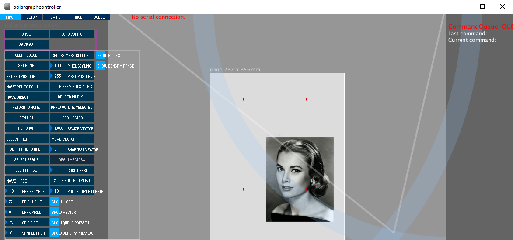
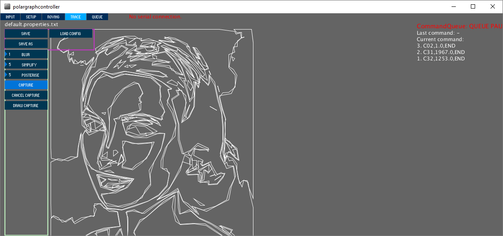
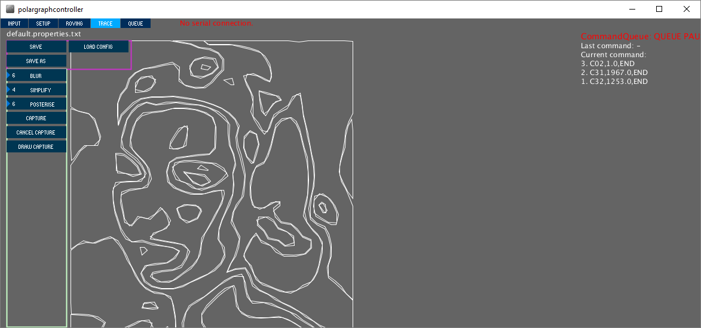
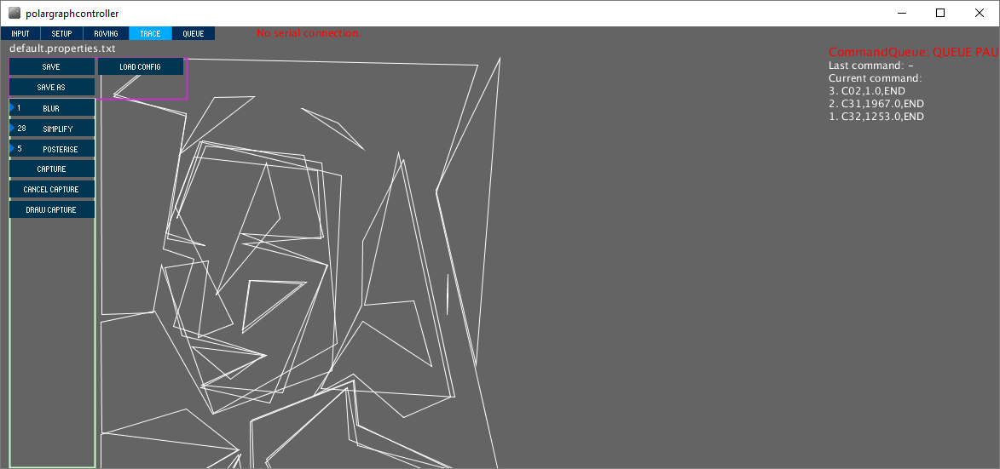
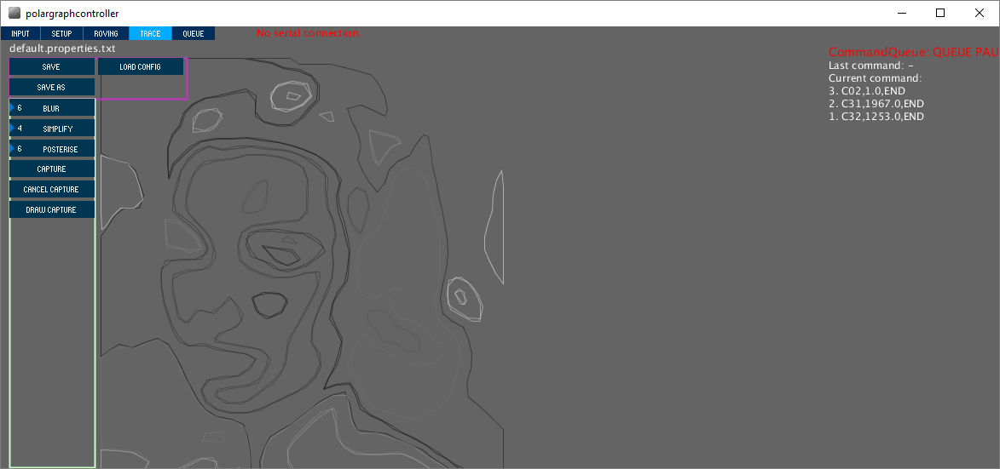
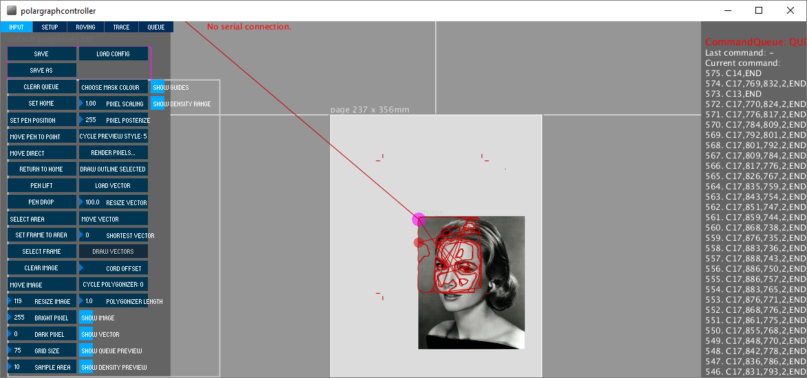

#What is it?

The Polargraph controller has a feature called TRACE, that crudely converts bitmaps into vectors.

Brief coverage: http://www.polargraph.co.uk/2013/04/a-flurry-of-activity/

#How do I install the dependencies?

I've only done it under Windows, you should have WinVDIG and Quicktime installed.

* WinVDIG: http://www.eden.net.nz/7/20071008/
* Quicktime: Just google for it.

(ps is this even still true? I'm not sure but now all my computers already have this on, so I can't check!)

#How does it work?

##1. Load a bitmap image.

Set the drawing frame to the area you want to draw. You can crop the image this way.

You set the frame by selecting an area and clicking "set frame to area" - it shows up as a set of red crop marks.
Notice the position of the crop marks on the screen grab.

##2. Trace

Switch to the TRACE tab, and see that the bitmapped image has been traced. 

Play with the number spinners here. Blur reduced the noise in the image, and higher numbers make for smoother shapes.

Simplify controls how many times the traced artwork is simplified. Higher numbers make for more abstract shapes.

Posterise controls how many different colours the image is reduced to. Higher numbers is more layers.

##3. Capture and draw

Click on CAPTURE to fix the drawing, and you'll see the preview change colour. The shading of the lines indicates the sequence of the drawing - darker lines are queued first.

Click DRAW CAPTURE to convert the capture into commands. These go into the command queue.

##4. How it looks

Look back at the INPUT tab, and notice that the drawing has been cropped by the drawing frame.

#It seems complicated

The reason for the capture-then-draw stage is because the mechanism was designed to take a snap from a live video feed, rather than a still. In that context the "capture" stage makes sense.